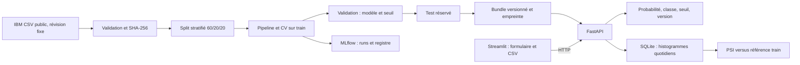

# MLOps – Industrialisation, déploiement et supervision d’un modèle ML

Projet portfolio CPU : données publiques IBM Telco → expériences MLflow → pipeline
scikit-learn versionné → API FastAPI → démonstration Streamlit → supervision agrégée.
Le bilan des **exécutions réelles** est dans [reports/VALIDATION.md](reports/VALIDATION.md).
Les résultats sont dans [reports/RESULTATS.md](reports/RESULTATS.md).
L'API et l'interface ont été exécutées et testées localement. Les conteneurs restent
à valider : le moteur Docker n'était pas accessible dans l'environnement de réalisation.

## Démarrage Windows (Python 3.12)

Ouvrir PowerShell dans ce dossier. Aucune activation du venv n'est nécessaire.

```powershell
py -3.12 -m venv .venv
.\.venv\Scripts\python.exe -m pip install -r requirements.lock
.\.venv\Scripts\python.exe -m pip install --no-deps -e .
.\.venv\Scripts\python.exe -m churn.data
.\.venv\Scripts\python.exe -m churn.train
.\.venv\Scripts\python.exe -m churn.monitor --demo
.\.venv\Scripts\python.exe -m pytest -q
.\.venv\Scripts\python.exe -m ruff check .
.\.venv\Scripts\python.exe -m ruff format --check .
```

Dans deux terminaux :

```powershell
.\.venv\Scripts\python.exe -m uvicorn churn.api:app --host 127.0.0.1 --port 8000
```

```powershell
.\.venv\Scripts\python.exe -m streamlit run app.py --server.headless=true --browser.gatherUsageStats=false
```

Ou `powershell -ExecutionPolicy Bypass -File scripts/start-local.ps1` pour les lancer
en arrière-plan ; les PID et logs sont dans `monitoring/`. Pour arrêter, vérifier
les PID de `monitoring/processes.json` et utiliser `Stop-Process -Id <PID>`.
Interface : <http://127.0.0.1:8501> ; OpenAPI : <http://127.0.0.1:8000/docs>.
Le fichier `.env` est lu par Compose ; pour les commandes Python, définir les variables
dans le shell (`$env:MODEL_VERSION='...'`). Les valeurs par défaut suffisent en local.

MLflow local (troisième terminal) :

```powershell
.\.venv\Scripts\python.exe -m mlflow server --backend-store-uri sqlite:///mlflow.db --host 127.0.0.1 --port 5000
```

## Démarrage Linux et Docker Compose

```bash
python3.12 -m venv .venv
.venv/bin/python -m pip install -r requirements.lock
.venv/bin/python -m pip install --no-deps -e .
.venv/bin/python -m churn.train
mkdir -p monitoring tracking data models reports
# Les conteneurs s'exécutent avec UID 10001 : autoriser l'écriture sur les dossiers montés.
sudo chown -R 10001:10001 monitoring tracking data models reports
cp .env.example .env
docker compose config
docker compose build
docker compose up -d
curl --fail http://127.0.0.1:8000/health
docker compose ps
```

Pour entraîner entièrement dans Docker depuis un clone sans artefacts :

```bash
mkdir -p monitoring tracking data models reports
sudo chown -R 10001:10001 monitoring tracking data models reports
docker compose build
docker compose up -d mlflow
# Attendre une réponse HTTP 200 de http://127.0.0.1:5000/health
docker compose --profile training run --rm train
docker compose up -d api ui
docker compose exec api python -m churn.monitor --db /app/monitoring/events.sqlite
```

La commande de supervision dans le conteneur crée le rapport dans son dossier `reports`;
pour le conserver, utiliser `docker cp` ou exécuter la commande Python sur l'hôte.
Les bases SQLite de l'entraînement Python et de Compose sont distinctes :
`mlflow.db`/`mlruns` sur l'hôte, `tracking/` pour Compose. Ne pas déplacer une base
MLflow sans migrer ses URI d'artefacts ; entraîner via le serveur Compose pour un
registre indépendant du chemin de la machine.
Les modèles et données ne sont pas inclus dans l'image ni suivis par Git.
L'archive livrée contient toutefois le modèle réellement entraîné, prêt pour l'API.

## Architecture



## Données et expérimentation

Source et conditions : [docs/DONNEES.md](docs/DONNEES.md).
7 043 lignes attendues, 19 variables, identifiant exclu et cible `Churn`.
`TotalCharges` contient des chaînes vides ; elles deviennent des valeurs absentes.
Leur médiane est apprise **sur train uniquement**. L'encodage et la standardisation
sont dans la même Pipeline sauvegardée. Chaque pli de CV réapprend son prétraitement.

Trois candidats : DummyClassifier, LogisticRegression (3 valeurs de C),
HistGradientBoostingClassifier (8 combinaisons). CV stratifiée 3 plis, scoring AP,
graine 42, parallélisme borné. Le modèle et son seuil (grille 0,01 à 0,99) minimisent
le coût `(5*FN + FP)/n` sur validation ; AP départage les ex aequo entre modèles.
FN=5 et FP=1 sont des coûts **relatifs hypothétiques**, à remplacer avec le métier.
Le gagnant est entraîné uniquement sur train et évalué une fois sur test.
Pas de réentraînement train+validation après sélection : le bundle correspond
exactement au modèle évalué. AP est nommé PR-AUC dans les rapports, avec sa définition.

```powershell
.\.venv\Scripts\python.exe -m churn.evaluate
```

Cette commande vérifie les métriques du même test ; elle ne sert pas à modifier le
modèle. Pour une nouvelle campagne de sélection, réserver un nouveau test ou une
validation externe. Les indices du split sont conservés dans le bundle.
Les exécutions MLflow enregistrent paramètres, validation, test du gagnant, schéma,
empreintes, EDA et pipeline dans le registre `telco-churn`.

## API et interface

`GET /health`, `GET /model`, `POST /predict`, `POST /predict/batch`, `GET /monitoring`.
La santé échoue au démarrage si le modèle manque ou si son empreinte est invalide.
Toutes les prédictions retournent `churn_probability`, `predicted_class`,
`threshold`, `model_version`. Validation stricte, catégories fermées, plages
numériques, cohérence des services, champs supplémentaires refusés, erreurs HTTP 422.
Lots de 1 à 1 000 clients. L'interface impose aussi 2 Mo par CSV.
CSV d'exemple : `reports/demo_customers.csv` ; pas d'identifiant ni cible.

```powershell
$clients = Import-Csv reports/demo_customers.csv
# Pour un appel direct JSON, utiliser l'exemple typé de /docs.
Invoke-RestMethod http://127.0.0.1:8000/health
Invoke-RestMethod http://127.0.0.1:8000/model
```

L'import CSV convertit les types tabulaires puis valide chaque ligne avant d'appeler
l'API. Une ligne invalide rejette le lot entier ; les résultats restent dans l'ordre
des lignes. L'export contient uniquement les résultats, pour limiter les données
personnelles. Streamlit ne charge jamais le modèle.

## Supervision

Logs JSON : méthode, chemin, code HTTP, latence, identifiant de requête aléatoire,
version, type d'erreur interne ; aucun corps, identifiant client ou email.
SQLite stocke les effectifs par variable/bin/jour UTC/version et dix bins de
probabilité, dans une transaction. La distribution ne permet pas de reconstruire
les lignes individuelles. Volume et histogramme visibles dans `/monitoring`.

Référence sur train : déciles pour les numériques, modalités pour les catégories,
bin supplémentaire pour les absences/inconnus. PSI avec lissage de Laplace +1.
PSI ≥0,10 : signal à examiner ; ≥0,20 : alerte si au moins 200 observations.
Ces seuils heuristiques doivent être adaptés au métier, à la taille et à la saisonnalité.
Fenêtre : journée UTC courante ; historique consultable avec `--day YYYY-MM-DD`.

```powershell
.\.venv\Scripts\python.exe -m churn.monitor --demo
.\.venv\Scripts\python.exe -m churn.monitor --db monitoring/events.sqlite
```

La simulation modifie tenure, MonthlyCharges et Contract d'un échantillon de train.
Elle est marquée `simulation: true` et ne représente pas un incident réel.
Le rapport compare aussi cet échantillon non perturbé à la référence.
**Dérive des entrées ≠ baisse de performance.** Pas de labels post-prédiction,
donc aucune métrique de performance en production. Pas d'alerting externe configuré.

## Livraison et cloud

[docs/LIVRAISON.md](docs/LIVRAISON.md) décrit images, versions et rollback.
[docs/CLOUD.md](docs/CLOUD.md) prépare une VM AWS EC2 avec disque EBS persistant,
sans créer de ressource ni publier. La CI vérifie lint, format, pytest et build Docker ;
elle entraîne seulement des fixtures synthétiques de contrôle, pas le benchmark complet.
Le workflow n'a pas été exécuté sur GitHub tant que le dépôt n'est pas publié.

## Comprendre et présenter

- [Guide pédagogique](docs/PEDAGOGIE.md)
- [Démonstration de cinq minutes](docs/DEMO.md)
- [Trois propositions CV](docs/CV.md)

Le code est livré sous MIT ; la notice IBM et sa licence restent distinctes.
Ne charger que des bundles joblib de confiance. La version locale n'a pas
d'authentification ni TLS et reste liée à localhost.
