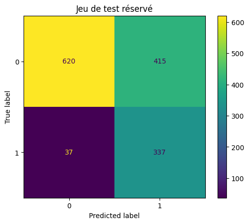

# Expériences et résultats mesurés

Exécution du 13 octobre 2026, CPU, Python 3.12. Les valeurs suivantes sont extraites des JSON produits par le pipeline.

## Données et exploration

7,043 lignes ; churn : 26.54% ; 11 TotalCharges absents.

Split stratifié : 4225 train, 1409 validation, 1409 test.

Taux de churn descriptif selon le contrat (benchmark complet) :

- Month-to-month : 42.71%
- One year : 11.27%
- Two year : 2.83%

Cette association ne démontre pas de causalité. Ces statistiques descriptives ne servent pas à apprendre le prétraitement.

## Comparaison sur validation

CV 3 plis sur train, scoring AP ; 3 C logistiques et 8 configurations de boosting. Aucun choix guidé par le test.

| Candidat | AP CV | AP validation | ROC-AUC | Seuil | Rappel | Coût/client |
|---|---:|---:|---:|---:|---:|---:|
| dummy | — | 0.2654 | 0.5000 | 0.01 | 100.00% | 0.7346 |
| logistic | 0.6609 | 0.6779 | 0.8600 | 0.17 | 92.51% | 0.4053 |
| gradient_boosting | 0.6687 | 0.6785 | 0.8599 | 0.14 | 93.05% | 0.4145 |

Paramètres choisis par CV :

- dummy : `{}`
- logistic : `{"classifier__C": 1}`
- gradient_boosting : `{"classifier__l2_regularization": 10.0, "classifier__learning_rate": 0.05, "classifier__max_leaf_nodes": 7}`

Gagnant : **logistic**, seuil **0.17**.
Le boosting obtient une AP de validation légèrement supérieure, mais la logistique minimise le coût FN=5, FP=1. Le choix métier prévaut sur cette petite différence de classement. Pas de gain économique réel revendiqué.

## Test réservé du gagnant

| Mesure | Valeur |
|---|---:|
| precision | 0.448138 |
| recall | 0.901070 |
| f1 | 0.598579 |
| roc_auc | 0.832445 |
| pr_auc | 0.622128 |
| cost_per_customer | 0.425834 |

AP = average_precision_score ; pas l'aire trapézoïdale de la courbe PR.

| Réel / prédit | Pas de churn | Churn |
|---|---:|---:|
| Pas de churn | 620 | 415 |
| Churn | 37 | 337 |

337 clients en churn détectés, 37 manqués et 415 faux positifs. Une équipe de rétention doit vérifier sa capacité avant d'adopter ce seuil. La probabilité n'est pas garantie calibrée.

## Version et reproductibilité

Bundle : `20261013T090154Z-796383b2` ; registre MLflow : `2`.
Données SHA-256 : `16320c9c1ec72448db59aa0a26a0b95401046bef5d02fd3aeb906448e3055e91`.
Pipeline SHA-256 : `2c7b9fa9cad804199b3847e6adfb23167a59d92d1e64fbc8b9e05ea1273ea4b2`.

Deux entraînements complets avec la graine 42 ont été exécutés ; les deux bundles conservés ont la même empreinte de pipeline et les mêmes métriques test. Cela démontre la répétabilité dans cet environnement, sans garantir l'identité bit à bit sur un autre système ou une autre bibliothèque BLAS.

## Simulation de dérive

500 observations de référence : 0 alerte. Observations perturbées : 3 alertes.

- Contract : PSI=2.4117
- tenure : PSI=5.6677
- MonthlyCharges : PSI=5.4828

Simulation explicite, seuil d'alerte 0,20, minimum 200 observations. Aucune performance de production mesurée sans labels.

## Limites

Données d'exemple IBM, partition aléatoire sans validation temporelle, coûts hypothétiques, absence de calibration et d'intervalles de confiance, risques de biais démographiques et généralisation non démontrée. Validation finale technique : [VALIDATION.md](VALIDATION.md).
